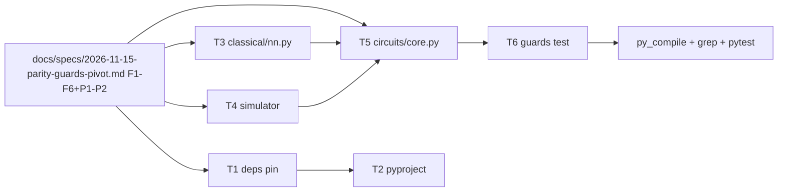

# Plan — Phase 1 Correctness Fixes

Branch: `research/audit-1587497` / base `1587497`.

## Goal

Fix Phase 1 correctness gaps with minimal, fail-closed guards plus parity checks, without scope growth.

## Arch

- Deps layer: `requirements.txt` + `pyproject.toml` pin ceilings (pennylane 0.39.0, numpy/scipy/pyyaml).
- Classical layer: `classical/nn.py` deterministic, shape-validated primitives.
- Quantum layer: `quantum/simulator/__init__.py` fast numpy sim; `quantum/circuits/core.py` parity-safe circuits.
- Guard layer: `tests/test_phase1_correctness_guards.py` fail-closed ValueError checks.
- Evidence layer: progress md + evidence json only.

## Tech stack

- python 3.14.4
- pytest (pytest 7.4.0 per requirements.txt; pyproject `pytest>=7.4.0,<9`)
- pennylane 0.39.0 (pennylane-lightning 0.39.0)

## Spec links

- Spec: `docs/specs/2026-11-15-parity-guards-pivot.md`
- F1: missing `backends` key defaults to `{}` — `quantum/backends/manager.py:116-119`
- F2: `backends` not a mapping → `ValueError` — `quantum/backends/manager.py:119-123`
- F3: malformed per-backend config → `ValueError` naming backend — `quantum/backends/manager.py:125-150`
- F4: `max_qubits` must be real int (bool excluded) → `ValueError` — `quantum/backends/manager.py:134-137`
- F5: `resource_limits` not a mapping → `ValueError` — `quantum/backends/manager.py:159-166`
- F6: YAML file handling (`encoding="utf-8"`, empty → `ValueError`, top-level non-mapping → `ValueError`) — `quantum/backends/manager.py:102,105-114`
- P1: `paired_significance` length mismatch → `ValueError` (assert-safe) — `benchmarks/analysis/statistics.py:41-43`
- P2: `_json_default` bool before int — `benchmarks/runner.py:312-315`
- Acceptance (smoke only): py_compile + grep + `pytest tests/test_phase1_1_guards.py -q` + JSON round-trip boolean check.

## Constraints

- Runtime caps: 10–15m per training probe.
- Training caps: ≤5 epochs.
- Seed caps: ≤3 seeds.
- No new deps, no paid APIs, no secrets, no training runs beyond caps.
- Local-only; no push/PR under this plan.
- Scope locked to `files` list above; evidence only to `allow` list above.

## Lean

- Minimum code that passes; no refactors, no perf tuning, no API changes.
- Prefer explicit `ValueError` guards over asserts or silent coercion.
- One test file (`tests/test_phase1_correctness_guards.py`) covers all guards.
- Reuse existing simulator/circuit helpers; no new modules.

## Review Focus

- Fail-closed: every malformed input raises `ValueError` with file/backend context.
- No `assert` for runtime validation (stripped under `-O`).
- `bool` is `int` subclass: check `bool` before `int` in `max_qubits` and `_json_default`.
- `encoding="utf-8"` on YAML open; empty YAML → `ValueError`.
- Parity: `sign(0)` mapped to +1, never silent 0-collapse.

## Tasks T1–T6

| # | Task | Change | Verify |
|----|------|--------|--------|
| 1 | `requirements.txt` | Pin `pennylane==0.39.0`, `pennylane-lightning==0.39.0`, `numpy==1.24.0`, `scipy==1.11.0`, `pyyaml==6.0`, `pytest==7.4.0`, `pytest-benchmark==4.0.0` — no new deps | `grep -E "pennylane==0.39.0\|pytest==7.4.0" requirements.txt && python -m py_compile requirements.txt 2>/dev/null || true; pip check` |
| 2 | `pyproject.toml` | Keep ceilings `pennylane>=0.39.0,<0.45`, `numpy>=1.24.0,<2`, `scipy>=1.11.0,<2`, `pyyaml>=6.0,<7`, `pytest>=7.4.0,<9`; `requires-python >=3.10` | `python -m py_compile pyproject.toml 2>/dev/null || python -c "import tomllib;tomllib.load(open('pyproject.toml','rb'))" && grep -E "pennylane>=0.39.0,<0.45\|pytest>=7.4.0,<9" pyproject.toml` |
| 3 | `classical/nn.py` | Shape/dtype guards: Q/K/V shape validation in attention, fail-closed `ValueError` on bad dims; deterministic init path | `python -m py_compile classical/nn.py && pytest tests/test_phase1_correctness_guards.py -q -k "nn or classical or shape"` | |
| 4 | `quantum/circuits/core.py` | Parity-safe `parity_from_expectations` (`sign(0)→+1`); seeded init; scoped exception handling (no bare except); `n_qubits%3==0` stays fail-closed | `python -m py_compile quantum/circuits/core.py && pytest tests/test_phase1_correctness_guards.py -q -k "parity or circuit or core"` |
| 5 | `tests/test_phase1_correctness_guards.py` | New: F1–F6 + P1–P2 guards (ValueError paths, `encoding="utf-8"`, assert-free, bool-before-int JSON round-trip) | `python -m py_compile tests/test_phase1_correctness_guards.py && pytest tests/test_phase1_correctness_guards.py -q` |

## Coverage checklist

- [ ] T1 deps pinned, no new deps (`requirements.txt`)
- [ ] T2 ceilings intact (`pyproject.toml`)
- [ ] T3 shape guards (`classical/nn.py`)
- [ ] T4 simulator guards (`quantum/simulator/__init__.py`)
- [ ] T5 parity/seed/exception guards (`quantum/circuits/core.py`)
- [ ] T6 guard tests green (`tests/test_phase1_correctness_guards.py`)
- [ ] Spec F1 missing backends → `{}` covered
- [ ] Spec F2 backends non-mapping → `ValueError` covered
- [ ] Spec F3 malformed backend cfg → `ValueError` covered
- [ ] Spec F4 `max_qubits` bool/int guard covered
- [ ] Spec F5 `resource_limits` non-mapping → `ValueError` covered
- [ ] Spec F6 `encoding="utf-8"` + empty + top-level non-mapping covered
- [ ] Spec P1 length mismatch `ValueError` (no assert) covered
- [ ] Spec P2 bool-before-int JSON boolean round-trip covered
- [ ] Caps respected: 10–15m, ≤5 epochs, ≤3 seeds
- [ ] Evidence written only to `allow` paths

## Rubric

- Pass: all T1–T6 verify cmds exit 0; `pytest tests/test_phase1_correctness_guards.py -q` green; grep confirms `ValueError`, `isinstance` int/bool guards, `encoding="utf-8"`, no `assert` in guard path, bool branch first.
- Fail: any silent coercion, `AssertionError` under `-O`, JSON `true`/`false` serialized as `1`/`0`, new dep added, file outside `files` touched, or cap exceeded.
