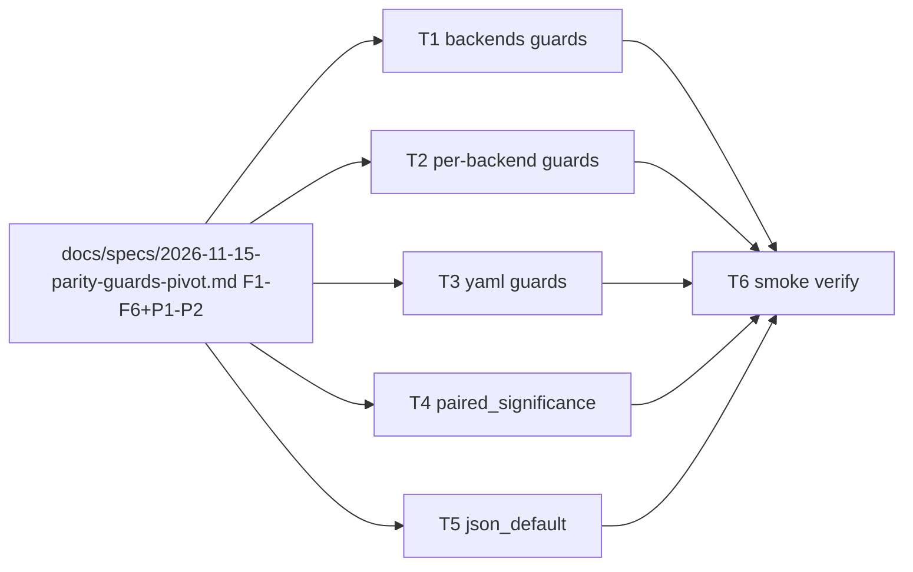

# Plan — Phase1b Fixes

Branch: `research/audit-1587497` / base `1587497`.

## Goal

Apply fail-closed parity guards F1-F6 + P1-P2 with smoke-only acceptance, without scope growth.

## Arch

- Config layer: `quantum/backends/manager.py` fail-closed YAML/backend guards F1-F6.
- Stats layer: `benchmarks/analysis/statistics.py` assert-free `paired_significance` P1.
- Runner layer: `benchmarks/runner.py` bool-before-int `_json_default` P2.
- Guard layer: `tests/test_phase1_1_guards.py` smoke (p=0.535 tie preserved).
- Evidence layer: progress md + evidence json only.

## Tech stack

- python 3.12 venv (`.venv/bin/python`)
- pytest
- pennylane 0.44.1

## Spec links

- Spec: `docs/specs/2026-11-15-parity-guards-pivot.md`
- F1: missing `backends` key defaults to `{}` — `quantum/backends/manager.py:116-119`
- F2: `backends` not a mapping → `ValueError` — `quantum/backends/manager.py:119-123`
- F3: malformed per-backend config → `ValueError` naming backend — `quantum/backends/manager.py:125-150`
- F4: `max_qubits` must be real int (bool excluded) → `ValueError` — `quantum/backends/manager.py:134-137`
- F5: `resource_limits` not a mapping → `ValueError` — `quantum/backends/manager.py:159-166`
- F6: YAML file handling (`encoding="utf-8"`, empty → `ValueError`, top-level non-mapping → `ValueError`) — `quantum/backends/manager.py:102,105-114`
- P1: `paired_significance` length mismatch → `ValueError` (assert-safe) — `benchmarks/analysis/statistics.py:41-43`
- P2: `_json_default` bool before int — `benchmarks/runner.py:312-315`
- ABANDONED: plan `9866b5a9` (`docs/plans/2026-11-15-phase1-correctness-fixes.md`) — close blocked by `missing-task-table`, RED-only honest outcome; superseded by this Phase1b plan, no code carried over.
- Acceptance (smoke only): py_compile + grep + `pytest tests/test_phase1_1_guards.py -q` + JSON round-trip boolean check.

## Constraints

- Local-only; no push/PR under this plan.
- No new deps, no secrets, no training runs.
- Smoke-only acceptance; no perf tuning, no API changes.
- Scope locked to `files` list above; evidence only to `allow` list above.

## Lean

- Minimum code that passes; no refactors.
- Prefer explicit `ValueError` guards over asserts or silent coercion.
- One guard test file covers all guards; reuse existing helpers, no new modules.

## Review Focus

- HIGH-1: Fail-closed — every malformed config raises `ValueError` with file/backend context, never silent coercion.
- HIGH-2: No `assert` for runtime validation in `statistics.py:41` (stripped under `-O`).
- HIGH-3: `bool` is `int` subclass — check `bool` before `int` in `max_qubits` guard.
- HIGH-4: `bool`/`np.bool_` before `np.integer` in `_json_default` so JSON yields `true`/`false`, not `1`/`0`.
- HIGH-5: YAML `open` uses `encoding="utf-8"`; empty YAML → `ValueError` naming file.
- HIGH-6: Top-level non-mapping YAML → `ValueError`; `backends`/`resource_limits` non-mapping → `ValueError`.
- HIGH-7: Length mismatch in `paired_significance` raises `ValueError`; smoke tie p=0.535 preserved.

## Tasks 1-6

| # | Task | Spec req | Files | Expected | Verify |
|---|---|---|---|---|---|
| 1 | backends mapping guards | F1-F2 | `quantum/backends/manager.py:116-123` | Missing `backends` → `{}`; non-mapping → `ValueError` | `python3 -m py_compile quantum/backends/manager.py && grep -n "ValueError" quantum/backends/manager.py` |
| 2 | per-backend guards | F3-F4 | `quantum/backends/manager.py:125-150` | Missing `device`/bad cfg → `ValueError` naming backend; `max_qubits` bool/non-int → `ValueError` | `python3 -m py_compile quantum/backends/manager.py && grep -n "isinstance.*bool" quantum/backends/manager.py` |
| 3 | yaml file guards | F5-F6 | `quantum/backends/manager.py:102-114,159-166` | `encoding="utf-8"`; empty/top-level non-mapping → `ValueError`; `resource_limits` non-mapping → `ValueError` | `python3 -m py_compile quantum/backends/manager.py && grep -n 'encoding="utf-8"' quantum/backends/manager.py` |
| 4 | paired_significance assert-safe | P1 | `benchmarks/analysis/statistics.py:41-43` | Length mismatch → `ValueError`, no `assert` | `python3 -m py_compile benchmarks/analysis/statistics.py && grep -n "ValueError" benchmarks/analysis/statistics.py` |
| 5 | json bool-before-int | P2 | `benchmarks/runner.py:312-315` | `bool`/`np.bool_` branch before `np.integer`; JSON round-trip yields boolean | `python3 -m py_compile benchmarks/runner.py && grep -n "_json_default" benchmarks/runner.py` |
| 6 | smoke acceptance | F1-F6+P1-P2 | `tests/test_phase1_1_guards.py` | py_compile green; guards unaffected; p=0.535 tie preserved; JSON boolean round-trip | `pytest tests/test_phase1_1_guards.py -q` |

## Per-task notes

- 1: F1 `raw.get("backends") is None` → `{}`; F2 non-dict → `ValueError`, never AttributeError.
- 2: F3 catches `KeyError`/`TypeError` per-backend, re-raises `ValueError` naming backend; F4 `bool` excluded from `int` check.
- 3: F6 `open(..., encoding="utf-8")`; `safe_load` → `None` → `ValueError` naming file; top-level non-mapping → `ValueError`; F5 same guard shape as F2.
- 4: P1 `len(baseline) != len(treatment)` → `ValueError`, not `assert`.
- 5: P2 `bool`/`np.bool_` handled before `np.integer` so booleans serialize as bool.
- 6: Smoke only: py_compile all three edited files + grep confirms + pytest + `json.dumps(obj, default=_json_default)` boolean check.

## Coverage checklist

- [ ] 1 backends missing/non-mapping covered (F1-F2)
- [ ] 2 per-backend + max_qubits covered (F3-F4)
- [ ] 3 yaml + resource_limits covered (F5-F6)
- [ ] 4 length mismatch ValueError, no assert (P1)
- [ ] 5 bool-before-int JSON boolean round-trip (P2)
- [ ] 6 smoke green: py_compile + grep + pytest + JSON check
- [ ] Evidence written only to `allow` paths

## Rubric

- Pass: all rows 1-6 Verify cmds exit 0; `pytest tests/test_phase1_1_guards.py -q` green; grep confirms `ValueError`, `isinstance` int/bool guards, `encoding="utf-8"`, no `assert` in guard path, bool branch first; JSON `true`/`false` not `1`/`0`.
- Fail: any silent coercion, `AssertionError` under `-O`, JSON boolean serialized as `1`/`0`, file outside `files` touched, or scope growth.
