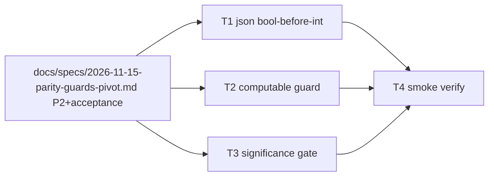

# Plan — Phase1c Corrective

Branch: `research/audit-1587497`.

## Goal

Corrective-only fixes in `benchmarks/runner.py` for parity-guards pivot acceptance, without scope growth.

## Arch

- Runner layer: `benchmarks/runner.py` `_json_default` bool-before-int (P2), degenerate-seed computable guard, significance computable gate.
- Evidence layer: progress md + evidence json only.

## Tech stack

- python 3.12 venv (`.venv/bin/python`)
- pytest
- numpy

## Spec links

- Spec: `docs/specs/2026-11-15-parity-guards-pivot.md`
- P2: `_json_default` bool before int — `benchmarks/runner.py:312-315`
- Acceptance (smoke only): py_compile + grep + JSON round-trip boolean check.
- Out of scope: F1-F6, P1, training runs, new deps, push/PR.

## Constraints

- Corrective-only; 10m cap; reversible.
- No training runs, no push, no spend.
- Local-only; no new deps, no secrets.
- Smoke-only acceptance; no perf tuning, no API changes.
- Scope locked to `files` list above; evidence only to `allow` list above.

## Lean

- Minimum code that passes; no refactors.
- Prefer explicit guards over silent coercion.
- Reuse existing helpers, no new modules.

## Review Focus

- HIGH-1: `bool`/`np.bool_` before `np.integer` in `_json_default` so JSON yields `true`/`false`, not `1`/`0`.
- HIGH-2: Degenerate seeds (<2) marked not-computed; no degenerate p=1.0 claim.
- HIGH-3: Significance computed only when computable and both models present.
- HIGH-4: No file outside `files` touched; no scope growth.

## Tasks 1-4

| # | Task | Spec req | Files | Expected | Verify |
|---|---|---|---|---|---|
| 1 | json bool-before-int | P2 | `benchmarks/runner.py:312-315` | `bool`/`np.bool_` branch before `np.integer`; JSON round-trip yields boolean | `python3 -m py_compile benchmarks/runner.py && grep -n "_json_default" benchmarks/runner.py` |
| 2 | degenerate-seed computable guard | Acceptance | `benchmarks/runner.py:189-204` | `len(seeds) >= 2` computable flag; n<2 CI marked not-computed | `python3 -m py_compile benchmarks/runner.py && grep -n "computable" benchmarks/runner.py` |
| 3 | significance computable gate | Acceptance | `benchmarks/runner.py:260-264` | significance only when computable and classical+quantum present | `python3 -m py_compile benchmarks/runner.py && grep -n "paired_significance" benchmarks/runner.py` |
| 4 | smoke verification | P2+Acceptance | `benchmarks/runner.py` | py_compile green; grep confirms bool-first; JSON boolean round-trip | `.venv/bin/python -m pytest tests/test_phase1_1_guards.py -q` |

## Per-task notes

- 1: P2 `bool`/`np.bool_` handled before `np.integer` so booleans serialize as bool.
- 2: CI and paired significance need >= 2 seeds; with fewer, mark not-computed.
- 3: Do not report degenerate significance; gate on computable flag.
- 4: Smoke only: py_compile + grep confirms + `json.dumps(obj, default=_json_default)` boolean check.

## Coverage checklist

- [ ] 1 bool-before-int JSON boolean round-trip (P2)
- [ ] 2 degenerate-seed computable guard covered
- [ ] 3 significance computable gate covered
- [ ] 4 smoke green: py_compile + grep + JSON check
- [ ] Evidence written only to `allow` paths

## Rubric

- Pass: all rows 1-4 Verify cmds exit 0; grep confirms bool branch first; JSON `true`/`false` not `1`/`0`; file outside `files` untouched.
- Fail: JSON boolean serialized as `1`/`0`, degenerate significance reported, file outside `files` touched, or scope growth.

Authorization: user 2026-11-16 blanket go-ahead narrowed to corrective-only (no training/push/spend, 10m cap, reversible).
