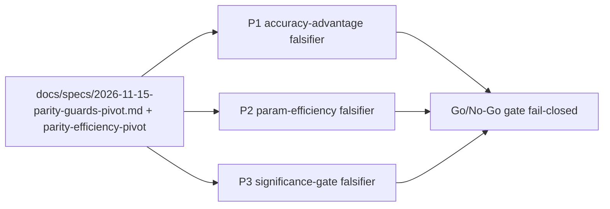

# Plan — Pilots Falsify

Branch: `research/audit-1587497`.

User approval transcribed 2026-11-16: "continue for big win" — bounded pilots only (3 max, caps, no sweeps/spend).
No gate fail-open. All gates fail-closed (`ValueError`, never silent coercion).

## Goal

Run at most 3 bounded local pilots to falsify parity/efficiency advantage claims before any scale-up. Stop on first falsification; no sweeps, no spend.

## Arch

- Pilot layer: `examples/demos/experiment_parity.py` bounded runs, results to `examples/demos/parity_results.json`.
- Guard layer: `benchmarks/runner.py` + `benchmarks/analysis/statistics.py` fail-closed gates (P1-P3).
- Evidence layer: progress md + evidence json only (see `allow`).

## Stack

- python 3.12 venv (`.venv/bin/python`)
- pytest
- numpy / PennyLane CPU only (free-only, local-only)

## Spec pivot

- Spec: `docs/specs/2026-11-15-parity-guards-pivot.md` (F1-F6 + P1-P2, fail-closed `ValueError`, smoke-only acceptance).
- Pivot: `docs/parity-efficiency-pivot.md` (P,F6-docs efficiency-only; 20 epochs N=3 seeds 42,99,137; Tie p=0.535 `significant=false`; `moe_6_9` naming; chance 48-50%).
- Out of scope: code changes beyond bounded pilot runs, secrets, push/PR.

## Constraints

- Time cap 10-15m total for all pilots; reversible.
- ≤5 epochs per pilot; ≤3 seeds per pilot (reuse 42,99,137).
- Local-only CPU; no GPU, no paid APIs, no sweeps, no spend.
- 3 pilots max; stop on falsification.
- Scope locked to `files` list above; evidence only to `allow` list above.

## Lean

- Minimum runs that falsify; no refactors, no new modules.
- Reuse existing helpers and configs; explicit fail-closed guards over silent coercion.
- No perf tuning, no API changes.

## Review Focus

- HIGH-1: No gate fail-open — degenerate/uncomputable significance never reported as p=1.0 or Tie-by-default.
- HIGH-2: `bool`/`np.bool_` before `np.integer` preserved; JSON stays `true`/`false`.
- HIGH-3: Capacity-match held; `moe_6_9` naming exact; no `moe_6_9_12`.
- HIGH-4: No file outside `files` touched; no sweep/spend; caps enforced.

## Tasks 1-4

| # | Task | Spec req | Files | Expected | Verify |
|---|---|---|---|---|---|
| 1 | P1 accuracy-advantage falsifier pilot | parity-efficiency-pivot Tie p=0.535 | `examples/demos/experiment_parity.py`, `examples/demos/parity_results.json` | ≤5 epochs ≤3 seeds local run at chance 48-50%, no quantum lead | `.venv/bin/python examples/demos/experiment_parity.py --epochs 5 --seeds 42,99,137 2>&1 \| head -20` |
| 2 | P2 param-efficiency falsifier pilot | parity-efficiency-pivot efficiency-only | `examples/demos/parity_results.json`, `benchmarks/runner.py` | same chance acc with fewer quantum params; no accuracy-win claim | `.venv/bin/python -m py_compile benchmarks/runner.py && grep -n "_json_default" benchmarks/runner.py` |
| 3 | P3 significance-gate falsifier pilot | P1-P2 guards fail-closed | `benchmarks/analysis/statistics.py`, `benchmarks/runner.py` | mismatch/computable gates raise `ValueError`; `significant=false` when p>=0.05 | `.venv/bin/python -m py_compile benchmarks/analysis/statistics.py && grep -n "paired_significance" benchmarks/analysis/statistics.py` |
| 4 | go/no-go gate verification | Acceptance smoke-only | `benchmarks/runner.py` | fail-closed gate green; evidence to `allow` only; no sweep/spend | `.venv/bin/python -m pytest tests/test_phase1_1_guards.py -q` |

## Per-task notes

- P1 falsifier: if any pilot shows statistically significant quantum lead (paired p<0.05, mean diff>0, CI excludes 50%), P1 survives; else Tie claim falsifies advantage — go/no-go = NO-GO to scale-up.
- P2 falsifier: if quantum/moe_6_9 reaches same chance band with ≤ quantum params, efficiency holds; if it needs more params for same chance, efficiency falsified — go/no-go = NO-GO to efficiency claim.
- P3 falsifier: if guards emit degenerate significance or coerce bool→int, gate fail-open — immediate NO-GO; must raise `ValueError` fail-closed.
- 4: Go only if P1-P3 all pass Verify exit 0, caps (10-15m, ≤5 epochs, ≤3 seeds, local-only) honored, and evidence written only to `allow` paths.

## Coverage checklist

- [ ] P1 accuracy falsifier run bounded (≤5 epochs, ≤3 seeds, local-only)
- [ ] P2 efficiency falsifier checked (params vs chance band)
- [ ] P3 significance gate fail-closed (no fail-open)
- [ ] Go/no-go recorded with falsifier outcomes
- [ ] Evidence written only to `allow` paths

## Rubric

- Pass: rows 1-4 Verify cmds exit 0; pilots within caps; falsifiers recorded; go/no-go explicit; no file outside `files` touched; no sweeps/spend.
- Fail: gate fail-open, sweep/spend, cap breach (>5 epochs, >3 seeds, >15m), file outside `files` touched, or missing go/no-go.

Authorization: user 2026-11-16 "continue for big win" narrowed to bounded pilots only (3 max, 10-15m caps, ≤5 epochs, ≤3 seeds, local-only, no sweeps/spend).
