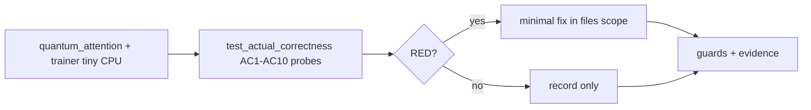

# Plan — Actual Correctness

Branch: `research/audit-1587497` @ `a3addab`.

Mission authorization transcribed 2026-11-16: autonomous Phase4.
Source: planner handoff (draft); scope transcribed to `files`/`allow` above.
Scope-locked: writes only to `files` above; evidence only to `allow` above. No secrets, no push.

## Goal

Prove actual correctness of the hybrid attention + trainer path on tiny CPU shapes with a failing-first probe suite, then gate strictly: RED → Fix, else NoFix (record only, no tuning to force green).

## Arch

- Subject layer: `hybrid/attention/quantum_attention.py` (`QuantumMultiHeadAttention`, classical + quantum heads, cache, split) + `classical/optimizers/trainer.py` (`HybridQuantumTrainer.training_step` / `evaluate`).
- Probe layer: `tests/test_actual_correctness.py` (AC1–AC10 probes, tiny shapes, fixed seeds, fail-closed asserts).
- Guard layer: per-probe guards (finite, bounds, determinism, mask, split-length, cache-hit, grad-step invariants); any violation exits non-zero, never silent pass.
- Evidence layer: progress md + evidence json only (see `allow`).

## Stack

- python 3.12 venv (`.venv/bin/python`), numpy CPU only, autograd path as in subject.
- `pytest` for `tests/test_actual_correctness.py` (`-q`).
- Tiny CPU shapes only (e.g. d_model 8–16, n_heads 2–4, seq 4–20, batch 1–2); local-only, no GPU, no network, no paid APIs.

## Spec

- Spec: `TBD-actual-correctness-AC1-AC10-AC-EV` — explicitly no external spec file. AC1–AC10 + AC-EV below are fail-closed.
- AC1 finite: forward output finite (no NaN/Inf) on tiny shapes, train and eval modes.
- AC2 loss-metric: `CrossEntropyLoss` finite; `evaluate` returns finite `eval_loss` and `accuracy` in [0,1]; preds shape matches labels.
- AC3 grads: `training_step` flat grads all finite; reported `grad_norm` finite and equals norm pre-clip; clipping to max_norm 1.0 honored when norm > 1.
- AC4 step: `training_step` returns `step` incremented by 1, `loss` float finite, `elapsed_ms` > 0; at least one param tensor changes after step.
- AC5 cache: eval path uses `CircuitResultCache` (cache hit returns identical projection, miss puts); train path bypasses cache (`use_cache` False when `_training` True).
- AC6 counts: head counts consistent (`classical_heads + quantum_heads == n_heads`, `head_dim == d_model // n_heads`); classical/quantum param maps partition all params with no overlap/drop.
- AC7 mask: masked positions get ~0 attention weight (classical path with boolean mask → softmax row sums to 1, masked columns ≈ 0).
- AC8 split: when S > `max_quantum_seq`, output length == S; remainder queries attend full prefix (no truncation bias); S <= max path unchanged.
- AC9 sim: fixed-seed rerun is deterministic (same weights init + same inputs → identical forward logits and identical `training_step` loss to exact float).
- AC10 derivs: attention weights rows sum to 1 (softmax derivative invariant); loss decreases or stays bounded after one small-lr step on tiny overfit batch (derivative direction sane, no explosion).
- AC-EV evidence: outcome per AC recorded to progress md + evidence json only; no claim beyond observed rows.
- Out of scope: model/code changes beyond `files` scope, sweeps, training runs beyond tiny probes, secrets, push/PR, confirmatory re-runs.

## Constraints

- Branch `research/audit-1587497`, local-only, reversible.
- Scope locked to `files` (subject + probe) and `allow` (evidence); `tests/*`, `hybrid/*`, `classical/*`, `research/*` otherwise untouched; no secrets.
- No push, no PR, no history rewrite, no new experiments beyond tiny probes.
- Time cap 3m for this plan-writing step; probe execution bounded tiny CPU (no sweeps, no spend).

## Lean

- Reuse-first: reuse existing `QuantumMultiHeadAttention`, `HybridQuantumTrainer`, `CircuitResultCache`; no new modules, no refactors, no perf tuning, no API changes.
- Minimum probe code that falsifies AC1–AC10; minimum fix only if Gate RED.

## Review Focus

- HIGH-1: actual correctness — real subject execution on tiny CPU, no mocks stubbing attention/sim/grad; seeds fixed, cache/sim/grad paths exercised honestly.
- HIGH-2: fail-closed gate — RED → Fix else NoFix; no fail-open green, no tuning to force match; guards exit non-zero on violation.
- HIGH-3: scope-locked — no file outside `files` touched; evidence only to `allow`; caps (tiny CPU, local-only, no sweeps/spend, no secrets/push) honored.

## Tasks 1-3

| # | Task | Spec req | Files | Expected | Verify |
|---|---|---|---|---|---|
| 1 | Actual-correctness probe suite | AC1–AC10 probes, AC-EV record | `tests/test_actual_correctness.py` | 10 failing-first probes (finite/loss-metric/grads/step/cache/counts/mask/split/sim/derivs) tiny CPU fixed seeds | `.venv/bin/python -m pytest tests/test_actual_correctness.py -q` |
| 2 | Gate RED?Fix:NoFix + guards | Gate RED→Fix else NoFix, guards fail-closed | `hybrid/attention/quantum_attention.py`, `classical/optimizers/trainer.py` | minimal fix only on RED, guards hold (seeds/cache/sim/grad invariants) | `.venv/bin/python -m pytest tests/test_actual_correctness.py -q` |
| 3 | evidence + caps verification | AC-EV evidence-only, caps | `docs/plans/2026-11-17-actual-correctness-progress.md`, `docs/plans/2026-11-17-actual-correctness-evidence.json` | outcome per AC recorded, caps honored, evidence only to `allow` | `ls -l docs/plans/2026-11-17-actual-correctness-progress.md docs/plans/2026-11-17-actual-correctness-evidence.json && .venv/bin/python -m json.tool docs/plans/2026-11-17-actual-correctness-evidence.json > /dev/null` |

## Per-task notes

- 1: tiny shapes only (d_model 8–16, heads 2–4, seq 4–20, batch 1–2); fixed seeds per probe; `-q`; first run expected RED (records actual gap); cache probe asserts train-bypass vs eval-hit; sim probe asserts exact determinism; grad probe asserts finite + clip invariant.
- 2: gate is strict — RED proves a real defect → minimal fix inside `files` scope only; green → NoFix record-only, no tuning; guards (finite/bounds/rows-sum-to-1/split-length/cache-hit/step-increment) all fail-closed.
- 3: pass only if Verify exit 0, AC1–AC10 + AC-EV covered, caps (tiny CPU, local-only, no sweeps/spend) honored, writes only to `allow` paths, no secrets/push, confirmatory locks untouched.

## Coverage checklist

- [ ] AC1 finite (forward finite train + eval)
- [ ] AC2 loss-metric (finite loss, accuracy in [0,1])
- [ ] AC3 grads (finite grads, norm + clip honored)
- [ ] AC4 step (step+1, loss/elapsed sane, params move)
- [ ] AC5 cache (train bypass, eval hit identical)
- [ ] AC6 counts (heads/dims + classical/quantum partition)
- [ ] AC7 mask (masked ≈ 0, rows sum to 1)
- [ ] AC8 split (S > max length == S, prefix attended)
- [ ] AC9 sim (fixed-seed determinism exact)
- [ ] AC10 derivs (weights sum to 1, small-lr step sane)
- [ ] AC-EV evidence written only to `allow` paths

## Rubric

- Pass: rows 1-3 Verify cmds exit 0; AC1–AC10 + AC-EV covered; Gate RED→Fix else NoFix honored; no file outside `files` touched; evidence only to `allow`; within caps; no secrets/push; confirmatory untouched.
- Fail: fail-open green, mocked correctness, file outside `files` touched, cap breach, sweep/spend, secret/push, tuning to force match, or confirmatory re-invoked.

Authorization: mission Phase4 autonomous — actual correctness only (local-only, scope-locked to `files`/`allow`, tiny CPU, no secrets, no push).
