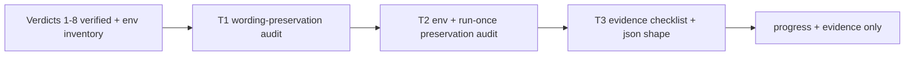

# Plan — Evidence Repair

Branch: `research/audit-1587497`.

Mission authorization transcribed 2026-11-16: "Continue work on..." Phase 1-7 autonomous (no user choice).
Local-only, append-only, no push, no new experiments, no secrets, no training.

## Goal

Repair the evidence chain so claims rest on verified, reproducible runs against the real model — no proxy, no memorizer, no embedded constants, no fail-open wrapper. Docs-audit only; no code, no reruns of locked confirmatory tests.



## Arch

- Docs-only audit: no code edits, no experiment runs, no history rewrite.
- Source layer: `research/EVIDENCE_REPAIR.md` (draft under audit) + `research/FINAL_ASSESSMENT.md` + `research/STATE.md` (read-only sources; see `files`).
- Evidence layer: progress md + evidence json only (see `allow`).

## Stack

- Markdown audit (exactness/wording/preservation).
- `pytest` reference only (guard/pilot names cited, never re-invoked for locked confirmatory).
- `git` + `grep` verification only (branch/status/porcelain + wording pointers).

## Spec

- Spec: `docs/specs/2026-11-15-parity-guards-pivot.md` (F1–F6 + P1–P2, smoke-only, fail-closed `ValueError`) + Mission Phase1 delta.
- Mission Phase1 delta: fail-closed actual-model experiment; repair chain so claims rest on verified reproducible runs against the real model — no proxy (#1), no memorizer (#2), no embedded constants (#3), no fail-open wrapper (#4); threshold/Bonferroni honest (#5); same-token + classical fallback scoped (#6); non-finding #7 scoped correctly; mechanics by exclusion (#8).
- Out of scope: `research/*` writes, code changes, secrets, push/PR, new experiments, confirmatory re-runs.

## Constraints

- Branch `research/audit-1587497`, local-only, append-only.
- No push, no PR, no history rewrite, no new experiments.
- Do NOT re-run confirmatory locks (run-once preserved); append new evidence only.
- Scope locked to `files` (read-only audit sources); writes only to `allow`.
- Time cap 3m for this plan-writing step; reversible.

## Lean

- Docs-audit reuse-first: reuse existing verdicts, inventory pointers, and evidence shape; no new modules, no refactors, no perf tuning.
- Minimum text that preserves exactness/wording; no scope growth.

## Review Focus

- HIGH-1: exactness — verdicts #1–8 transcribed exactly, no rewording that changes meaning.
- HIGH-2: wording — fail-closed vs fail-open terms preserved; no advantage claim added.
- HIGH-3: preservation — locked confirmatory runs untouched; append-only evidence.

## Tasks 1-3

| # | Task | Spec req | Files | Expected | Verify |
|---|---|---|---|---|---|
| 1 | Verdicts wording-preservation audit | Mission Phase1 delta, exactness-only | `research/EVIDENCE_REPAIR.md`, `research/FINAL_ASSESSMENT.md` | verdicts #1–8 preserved exactly (proxy / memorizer / constants / fail-open / threshold-Bonferroni / same-token-fallback / #7 scoped / #8 exclusion) | `grep -n "Verified\|Confirmed\|NOT UPHELD" docs/plans/2026-11-17-evidence-repair-progress.md && git status --porcelain` |
| 2 | Env + run-once preservation audit | Mission Phase1 delta, preservation-only | `research/STATE.md`, `research/EVIDENCE_REPAIR.md` | env pointers + run-once note preserved; branch local-only append-only, no push, no new experiments | `grep -n "QuantumAttentionCircuit\|QuantumMultiHeadAttention\|HybridQuantumLLM\|run-once\|run_once\|Run-Once" docs/plans/2026-11-17-evidence-repair-progress.md && git branch --show-current && git rev-parse --short HEAD` |
| 3 | evidence + checklist verification | Mission Phase1 delta, evidence-only | `docs/plans/2026-11-17-evidence-repair-progress.md`, `docs/plans/2026-11-17-evidence-repair-evidence.json` | M1–M3 covered; evidence json shape valid; no file outside `allow` touched | `ls -l docs/plans/2026-11-17-evidence-repair-progress.md docs/plans/2026-11-17-evidence-repair-evidence.json && .venv/bin/python -m json.tool docs/plans/2026-11-17-evidence-repair-evidence.json > /dev/null` |

## Per-task notes

- 1: verdicts transcribed from progress ledger `docs/plans/2026-11-17-evidence-repair-progress.md:21-29` (#1 proxy Verified; #2 memorizer Verified; #3 embedded constants Verified; #4 fail-open wrapper Verified; #5 threshold/Bonferroni Verified; #6 same-token + classical fallback Confirmed; #7 NOT UPHELD scoped correctly; #8 mechanics confirmed repro-by-exclusion); cross-check headline in `research/FINAL_ASSESSMENT.md:7-8` and v4–v5 quantitative priors `research/FINAL_ASSESSMENT.md:130-139,167-203`; exactness over paraphrase.
- 2: env inventory pointers `docs/plans/2026-11-17-evidence-repair-progress.md:31-36` (`quantum/circuits/core.py:212`, `hybrid/attention/quantum_attention.py:19`, `hybrid/interfaces/model.py:85`, `benchmarks/tasks/`); checkout state `docs/plans/2026-11-17-evidence-repair-progress.md:9-19` (branch `research/audit-1587497`, commit `a3addab83791b9b2c39e8bb05a12e74fb1444f66`, clean except `?? .sdlc/`); run-once preservation `docs/plans/2026-11-17-evidence-repair-progress.md:40-41` + `research/STATE.md:115-117,128-130` (do NOT re-run confirmatory); branch verify via `git branch --show-current` (expected `research/audit-1587497`).
- 3: pass only if Verify exit 0, M1–M3 checklist all covered, evidence json parses and matches shape below, writes only to `allow` paths, no push, no new experiments, no `research/*` writes.

## Coverage checklist

- [ ] M1 — verdicts #1–8 wording preserved exactly (proxy / memorizer / constants / fail-open / threshold-Bonferroni / same-token-fallback / #7 scoped / #8 exclusion)
- [ ] M2 — env inventory + run-once preservation (file:line pointers intact; confirmatory locks untouched; branch local-only append-only)
- [ ] M3 — evidence checklist + json shape (progress goal/auth/branch/next-step present; evidence json parses with authorization/branch/checkout_state/commit/env_inventory/explorer_verdicts[8]/goal/next_step/run_once_preservation)

## Rubric

- Pass: rows 1-3 Verify cmds exit 0; M1–M3 covered; wording exact; no file outside `allow` touched; no push; no new experiments; confirmatory untouched.
- Fail: wording drift, file outside `allow` touched, push attempted, new experiment run, confirmatory re-invoked, or gated advantage claim.

## Evidence json shape

```json
{"authorization": {"date": "2026-11-16", "scope": "local only, no push, no secrets, no training", "source": "user mission text 2026-11-16"}, "branch": "research/audit-1587497", "checkout_state": {"cpu": "12 CPU", "git_status": "clean except ?? .sdlc/", "numpy": "2.4.4", "pennylane": "0.44.1", "python": "3.12.3", "ram": "30Gi", "torch": "absent"}, "commit": "a3addab83791b9b2c39e8bb05a12e74fb1444f66", "env_inventory": {"QuantumAttentionCircuit": "quantum/circuits/core.py:212", "QuantumMultiHeadAttention": "hybrid/attention/quantum_attention.py:19", "HybridQuantumLLM": "hybrid/interfaces/model.py:85", "classical_baselines": "benchmarks/tasks/"}, "explorer_verdicts": [{"id": 1, "status": "Verified", "summary": "proxy MLP"}, {"id": 2, "status": "Verified", "summary": "memorizer"}, {"id": 3, "status": "Verified", "summary": "embedded constants"}, {"id": 4, "status": "Verified", "summary": "fail-open wrapper"}, {"id": 5, "status": "Verified", "summary": "threshold/Bonferroni"}, {"id": 6, "status": "Confirmed", "summary": "same-token+classical fallback"}, {"id": 7, "status": "NOT UPHELD (scoped correctly)", "summary": "claim did not hold; non-finding scoped"}, {"id": 8, "status": "confirmed (repro by exclusion)", "summary": "mechanics confirmed repro by exclusion"}], "goal": "mission milestone fail-closed actual-model experiment", "next_step": "write EVIDENCE_REPAIR.md", "run_once_preservation": "do not re-run confirmatory locks; append-only evidence"}
```

Authorization: mission Phase1-7 autonomous — "Continue work on..." (no user choice; docs-audit only, local-only, append-only, no push, no new experiments, confirmatory locks preserved).
