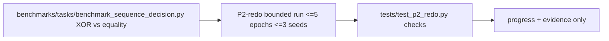

# Plan — P2 Redo

Branch: `research/audit-1587497`.

User approval transcribed 2026-11-16: "go ahead" post-Track-C.
No gate fail-open. Exploratory redo only.

## Goal

Redo P2 param-efficiency check bounded on sequence-decision (XOR vs equality control) to see if quantum reaches chance band with fewer params. No advantage claim; record outcome only.

## Arch

- Task layer: `benchmarks/tasks/benchmark_sequence_decision.py` (`generate_xor_sequence_decision` + `generate_equality_sequence_decision` control).
- Check layer: `tests/test_p2_redo.py` bounded assertions only (no sweeps).
- Evidence layer: progress md + evidence json only (see `allow`).

## Stack

- python 3.12 venv (`.venv/bin/python`)
- pytest
- numpy / PennyLane CPU only (local-only)

## Spec

- Spec: TBD-exploratory — explicitly no approved spec. This plan is exploratory, fail-open (no gate).
- No fail-closed gate is wired in this redo; outcomes are recorded, not gated.
- Out of scope: code changes beyond bounded P2 redo, secrets, push/PR.

## Constraints

- Time cap 10-15m total; reversible.
- ≤5 epochs per run; ≤3 seeds per run (reuse 42,99,137).
- Local-only CPU; no GPU, no paid APIs, no sweeps, no spend.
- Scope locked to `files` list above; evidence only to `allow` list above.

## Lean

- Minimum bounded rerun that answers P2; no refactors, no new modules.
- Reuse existing generators and configs; no perf tuning, no API changes.

## Review Focus

- HIGH-1: No approved spec — must stay exploratory fail-open, no gated claim.
- HIGH-2: Caps enforced (≤3 seeds, ≤5 epochs, 10-15m, local-only).
- HIGH-3: No file outside `files` touched; evidence only to `allow`.
- HIGH-4: XOR vs equality control kept; no accuracy-win claim.

## Tasks 1-3

| # | Task | Spec req | Files | Expected | Verify |
|---|---|---|---|---|---|
| 1 | P2-redo bounded run (XOR vs equality) | TBD-exploratory, efficiency-only | `benchmarks/tasks/benchmark_sequence_decision.py` | ≤5 epochs ≤3 seeds local run, chance-band vs params recorded | `.venv/bin/python -m py_compile benchmarks/tasks/benchmark_sequence_decision.py && grep -n "generate_xor_sequence_decision" benchmarks/tasks/benchmark_sequence_decision.py` |
| 2 | P2-redo checks | TBD-exploratory, record-only | `tests/test_p2_redo.py` | bounded assertions, fail-open record, no gate | `.venv/bin/python -m py_compile tests/test_p2_redo.py && .venv/bin/python -m pytest tests/test_p2_redo.py -q` |
| 3 | evidence + caps verification | TBD-exploratory, evidence-only | `docs/plans/2026-11-17-p2-redo-progress.md`, `docs/plans/2026-11-17-p2-redo-evidence.json` | outcome recorded, caps honored, no sweep/spend | `ls -l docs/plans/2026-11-17-p2-redo-progress.md docs/plans/2026-11-17-p2-redo-evidence.json` |

## Per-task notes

- 1: XOR favorable + equality control only; if quantum needs more params for same chance band, efficiency does not hold — record only, no gate.
- 2: checks are record-only fail-open; no `ValueError` gate required under TBD-exploratory.
- 3: pass only if Verify exit 0, caps (10-15m, ≤5 epochs, ≤3 seeds, local-only) honored, evidence written only to `allow` paths.

## Coverage checklist

- [ ] P2-redo bounded run (≤5 epochs, ≤3 seeds, local-only)
- [ ] Efficiency recorded (params vs chance band, XOR + control)
- [ ] Fail-open recorded (no gated claim)
- [ ] Evidence written only to `allow` paths

## Rubric

- Pass: rows 1-3 Verify cmds exit 0; within caps; outcome recorded; no file outside `files` touched; no sweeps/spend.
- Fail: cap breach (>5 epochs, >3 seeds, >15m), sweep/spend, file outside `files` touched, or gated advantage claim.

Authorization: user 2026-11-16 "go ahead" post-Track-C narrowed to fail-open exploratory P2 redo only (caps ≤3 seeds, ≤5 epochs, 10-15m, local-only, no sweeps/spend).
