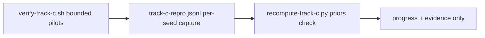

# Plan — Phase6 Repro

Branch: `research/audit-1587497`.

User approval transcribed 2026-11-16: "continue with next".
No gate fail-open. Repro-only; confirmatory EXCLUDED.

## Goal

Reproduce Track C exploratory priors with bounded local reruns and record match/mismatch only. No new claim; no advantage claim.

## Arch

- Script layer: `verify-track-c.sh` (bounded pilot reruns only, no sweeps).
- Capture layer: `track-c-repro.jsonl` (per-seed repro records only).
- Recompute layer: `recompute-track-c.py` (priors recompute vs recorded bands only).
- Evidence layer: progress md + evidence json only (see `allow`).

## Stack

- python 3.12 venv (`.venv/bin/python`)
- pytest with `-s` capture where per-seed values needed
- numpy CPU only (local-only)

## Spec

- Spec: TBD-repro-only — explicitly no approved spec file. This plan is repro-only, fail-open (no gate).
- Priors (exploratory, record-only): XOR redo classical_bal 0.9722 ([1,0.9167,1]) vs quantum 0.4912 ([0.51,0.48,0.48]) vs chance 0.50; P1 inflation +0.229 (0.677 leaky vs 0.448 disjoint); P3 dense-train 1.96x (observed 1.89-2.03 in 1.8-2.2 band).
- Repro passes on honest record (match or mismatch logged as observed); no `ValueError` gate is wired.
- Out of scope: confirmatory tests (EXCLUDED, run-once locked — must not re-run), code changes beyond bounded repro, secrets, push/PR.

## Constraints

- Time cap <=15m total; reversible.
- Local-only CPU; no GPU, no paid APIs, no sweeps, no spend.
- Confirmatory EXCLUDED: `tests/test_confirmatory.py` and `tests/test_confirmatory_mag.py` must not run.
- Scope locked to `files` list above; evidence only to `allow` list above.

## Lean

- Minimum bounded rerun that reproduces Track C priors; no refactors, no new modules.
- Reuse existing pilots and configs; no perf tuning, no API changes.

## Review Focus

- HIGH-1: TBD-repro-only — must stay repro-only fail-open, no gated claim.
- HIGH-2: Caps enforced (<=15m, local-only, no sweeps/spend).
- HIGH-3: No file outside `files` touched; evidence only to `allow`.
- HIGH-4: Confirmatory EXCLUDED (locked run-once tests never invoked).
- HIGH-5: Priors checked honestly (0.9722/0.4912/+0.229/1.96x bands) — mismatch recorded as-is, no tuning to force match.

## Tasks 1-3

| # | Task | Spec req | Files | Expected | Verify |
|---|---|---|---|---|---|
| 1 | Track C bounded verify | TBD-repro-only, rerun-only | `verify-track-c.sh` | bounded pilots local rerun, per-seed lines captured | `bash verify-track-c.sh` |
| 2 | Priors recompute | TBD-repro-only, record-only | `recompute-track-c.py`, `track-c-repro.jsonl` | recompute vs priors (0.9722/0.4912/+0.229/1.96x), match/mismatch recorded | `.venv/bin/python recompute-track-c.py` |
| 3 | evidence + caps verification | TBD-repro-only, evidence-only | `docs/plans/2026-11-17-phase6-repro-progress.md`, `docs/plans/2026-11-17-phase6-repro-evidence.json` | outcome recorded, caps honored, confirmatory untouched | `ls -l docs/plans/2026-11-17-phase6-repro-progress.md docs/plans/2026-11-17-phase6-repro-evidence.json && .venv/bin/python -m json.tool docs/plans/2026-11-17-phase6-repro-evidence.json` |

## Per-task notes

- 1: bounded pilots only (<=15m, local-only); `-s` where per-seed values needed; if priors do not reproduce, record mismatch only, no gate.
- 2: recompute reads `track-c-repro.jsonl` only; checks are record-only fail-open; no threshold/gate change.
- 3: pass only if Verify exit 0, caps (<=15m, local-only, no sweeps/spend) honored, confirmatory never invoked, evidence written only to `allow` paths.

## Coverage checklist

- [ ] Track C bounded verify (<=15m, local-only, `-s` capture)
- [ ] Priors recomputed (0.9722/0.4912/+0.229/1.96x, match/mismatch recorded)
- [ ] Confirmatory EXCLUDED (never invoked)
- [ ] Evidence written only to `allow` paths

## Rubric

- Pass: rows 1-3 Verify cmds exit 0; within caps; outcome recorded as match/mismatch; no file outside `files` touched; confirmatory untouched; no sweeps/spend.
- Fail: cap breach (>15m), sweep/spend, file outside `files` touched, confirmatory invoked, or gated advantage claim.

Authorization: user 2026-11-16 "continue with next" narrowed to fail-open repro-only Phase6 (caps <=15m, local-only, confirmatory EXCLUDED, no sweeps/spend).
